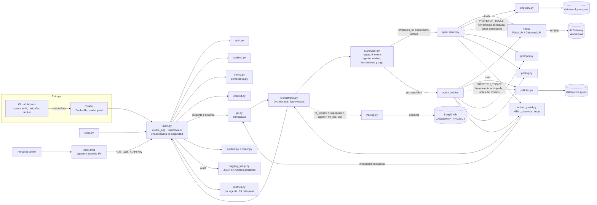

# Arquitectura del HR Assistant

API FastAPI sin estado, modelo detrás de una interfaz y datos de solo lectura. La sesión 2 agrega observabilidad. La
sesión 3 agrega el modelo real por AI Gateway y cuatro palancas de costo. La sesión 4 agrega acceso por clave, límite de
peticiones, compliance al arrancar, contenedor, CI y Render. La sesión 5 reemplaza el agente único por un supervisor con
dos especialistas (`directory` y `policies`), y agrega detección de PII, validación de la salida, auditoría completa,
encabezados de seguridad, trazas por agente y herramienta anticipada. Ver `adr/` (0014 a 0018).

Flujo con herramienta anticipada (ADR 0018):
1. El supervisor elige especialista y motivo, y además la herramienta y sus argumentos (`default` no trae ninguna).
2. Se audita `agent_selected` y corre el especialista.
3. Con `PREFETCH_TOOLS=true`, el especialista ejecuta esa herramienta en código, antes de llamar al modelo. Cuenta como
   una vuelta de `AGENT_MAX_STEPS`, va en `tools_used`, se audita como `tool_call` con `prefetched: true` y deja el
   span `tool:<nombre>`.
4. El resultado entra a la conversación como `Resultado de la herramienta: ...` y el modelo solo redacta la respuesta.
5. Si el modelo repite la herramienta con los mismos argumentos, recibe el error de llamada repetida.
6. `agent_run` y los metadatos de `hr_request` registran `prefetched`.

Módulos nuevos de la sesión 5:
- `supervisor.py`: elige especialista, motivo, herramienta y argumentos con reglas en código.
- `policies.py`: `get_policy` y `list_policies` sobre `data/policies.json`.
- `prompts.py`: un prompt corto por especialista.
- `pii.py`: detección y enmascarado de datos personales (tipos, nunca valores).
- `output_guard.py`: bloquea HTML y secretos, recorta el largo.
- `agent.py`: un agente parametrizado por herramientas y prompt; lectura tolerante del JSON del modelo; ejecuta la
  herramienta anticipada.
- `orchestrator.py`: `Orchestrator` corre el flujo supervisor, especialista, salida segura (PII y `output_guard`) y
  abre el árbol de trazas `hr_request` > `supervisor` > `agent:<nombre>`; devuelve un `Reply`.
- `main.py`: `create_app`, middleware, validación de entrada, encabezados, auditoría de acceso y campos de la
  respuesta; delega el flujo en `Orchestrator`.
- `tracing.py`: árbol por petición con proyecto explícito y cliente inyectable (ADR 0017).
- `metrics.py`: agrega métricas por agente, detecciones de PII y salidas bloqueadas.

Los módulos de las sesiones 1 a 4 (`config`, `compliance`, `auth`, `ratelimit`, `directory`, `llm`, `router`, `window`,
`pricing`, `clock`, `context`, `logging_setup`) conservan su responsabilidad.
