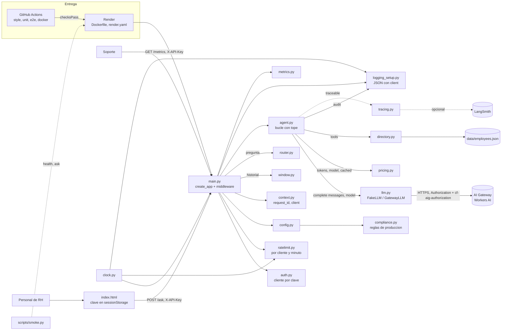

# Arquitectura del HR Assistant

API FastAPI sin estado, un agente con bucle con tope, modelo detrás de una interfaz y un directorio de empleados
de solo lectura. La sesión 2 agrega observabilidad. La sesión 3 agrega el modelo real por AI Gateway y cuatro
palancas de costo. La sesión 4 agrega acceso por clave, límite de peticiones, compliance al arrancar, contenedor, CI
y publicación en Render, y el gateway autenticado con un segundo token (`CF_AIG_TOKEN`). Ver `adr/`.

Módulos:
- `config.py`: configuración validada al arrancar; aplica `compliance.py` en producción. Lee `CF_AIG_TOKEN` (secreta,
  `repr=False`, vacía por omisión).
- `compliance.py`: reglas de `ENVIRONMENT=production`; el producto no arranca si falla alguna, incluida
  `CF_AIG_TOKEN` vacía con `gateway`.
- `auth.py`: parsea `API_KEYS` y resuelve el cliente por `X-API-Key`; nunca registra la clave.
- `ratelimit.py`: límite por cliente y minuto en memoria, con reloj inyectado y `Retry-After`.
- `directory.py`: herramientas de solo lectura.
- `llm.py`: interfaz `complete(messages, model)`, modelo simulado y cliente del gateway, que manda
  `cf-aig-authorization` solo si hay `CF_AIG_TOKEN`.
- `router.py`: elige modelo y motivo por pregunta con reglas en código.
- `window.py`: recorta el historial a la ventana configurada.
- `pricing.py`: costo por llamada con la tabla de precios; las llamadas cacheadas valen 0.
- `agent.py`: bucle herramienta/respuesta con tope, con auditoría y acumulado de costo.
- `main.py`: rutas `/`, `/health`, `/ask`, `/metrics`, middleware de `request_id`, 401, 429 y 502.
- `clock.py`: reloj inyectable.
- `context.py`: `request_id` y `client` de la petición actual.
- `logging_setup.py`: eventos JSON de una línea, con `client`.
- `metrics.py`: contadores, percentiles, SLO y costo acumulado por proceso.
- `tracing.py`: trazas opcionales con datos ocultos por omisión.
